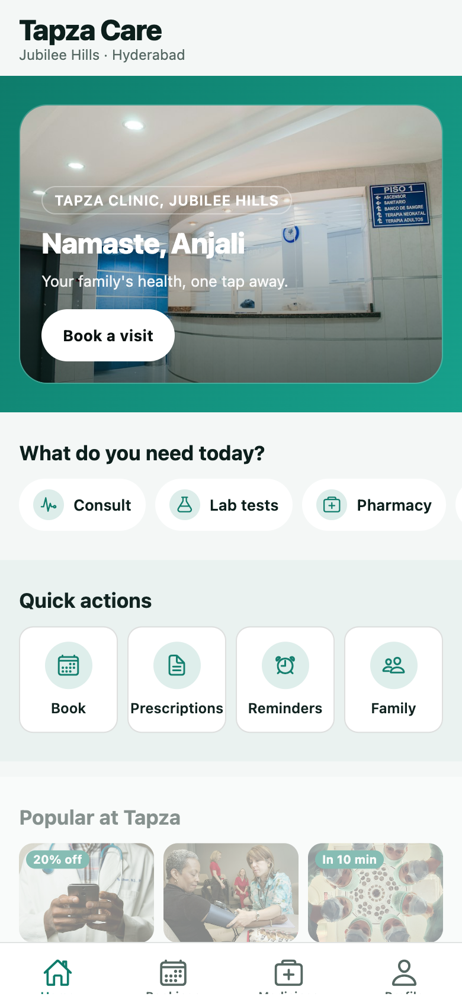
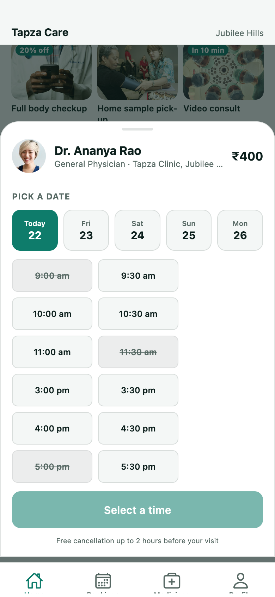
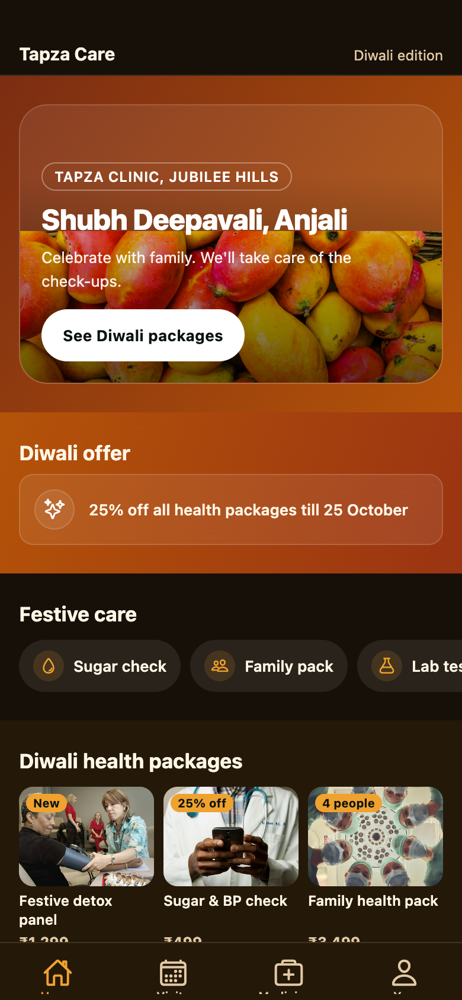
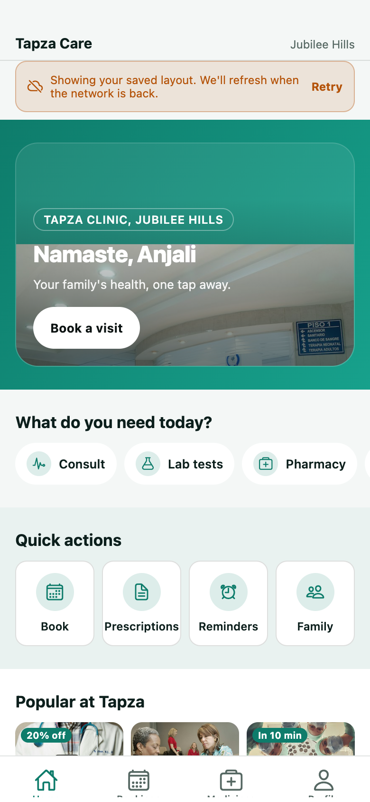

# Tapza Care

A config-driven clinic app built with React Native + Expo. The home screen, the tab bar, the
colours and the type are all rendered from a `GET /config` payload — the app ships no layout of
its own. Two payloads (a normal day and a Diwali festival) can be switched at runtime without a
reload or a rebuild.

| Home (normal) | Booking sheet | Diwali config | Offline cache |
| --- | --- | --- | --- |
|  |  |  |  |

More in [`docs/screenshots`](docs/screenshots). **Demo video (1:44):**
[`docs/demo.mp4`](docs/demo.mp4) — a real capture of the web build, captions burned in, no audio.
[How it was recorded](docs/demo.md).

**APK:** [download the signed build](https://expo.dev/artifacts/eas/4I_fkkAaSlTsnRHPjH3pIQR3AKRQ_Jo3QMpBaSFDDHQ.apk)
· **Tests:** 13 passing in 4 suites · **Type check:** clean (`tsc --noEmit`) · **expo-doctor:** 20/20

---

## Run it

```bash
npm install
npx expo start        # press w for web, or scan the QR with Expo Go
```

- Web: `npx expo start --web`
- Android: `npx expo start --android` with an emulator, or scan the QR with Expo Go.
- Type check: `npm run typecheck`
- Tests: `npm test` (13 tests, 4 suites)
- Screenshots + smoke test: `npm run shots` while the web dev server is running
- Re-record the demo video: `npm run demo:video` (web server running, ffmpeg available)

Requires Node 20+. No native toolchain is needed for the web or Expo Go paths.

### APK

Built and signed on EAS (no local Android SDK):

**[Download the APK](https://expo.dev/artifacts/eas/4I_fkkAaSlTsnRHPjH3pIQR3AKRQ_Jo3QMpBaSFDDHQ.apk)** ·
[build page](https://expo.dev/accounts/ankushk385/projects/tapza-care/builds/05dda15d-cf07-49e9-a88c-1de2cbb63ec6) ·
versionCode 1 · built 23 Oct 2026 · internal distribution, signed with the EAS-managed keystore

Open the link on an Android device, allow "install unknown apps" for the browser, and install.
To rebuild:

```bash
npx eas-cli login            # or export EXPO_TOKEN=...
npm run build:apk            # npx eas-cli build --platform android --profile preview
```

`eas.json` defines the `preview` profile (`buildType: "apk"`, internal distribution). The project is
linked as `@ankushk385/tapza-care`, so no interactive `eas init` is needed.

---

## The config contract

`src/types/config.ts` is the single source of truth: zod schemas at runtime, types inferred from
them. Nothing reaches a component before it is parsed.

```jsonc
{
  "version": 3,
  "theme": { "primary": "#0E7C6B", "background": "#F4F7F6", "surface": "#FFFFFF", ... },
  "tabs": [{ "id": "tab-home", "label": "Home", "icon": "home", "screen": "home" }],
  "sections": [
    {
      "id": "sec-hero",
      "type": "hero_banner",                      // free-form string
      "background": { "kind": "gradient", "value": "#0E7C6B,#17A18C" },
      "title": "Tapza Clinic, Jubilee Hills",
      "items": [{ "id": "hero-1", "imageUrl": "...", "greeting": "Namaste, Anjali" }]
    }
  ]
}
```

Six section types are implemented:

| `type` | Component | What it renders |
| --- | --- | --- |
| `hero_banner` | `sections/HeroBanner.tsx` | photo + scrim + greeting + CTA, parallax on scroll |
| `category_chips` | `sections/CategoryChips.tsx` | edge-to-edge horizontal chips |
| `quick_actions` | `sections/QuickActions.tsx` | icon tiles that navigate to a tab |
| `service_grid` | `sections/ServiceGrid.tsx` | 3-column grid with price + badge |
| `doctor_carousel` | `sections/DoctorCarousel.tsx` | doctor cards, fetches `/doctors`, inline empty state |
| `offer_strip` | `sections/OfferStrip.tsx` | single-line offer |

**Unknown types are skipped, not crashed on.** `type` is `z.string()`, `SectionRenderer` switches
on it, and the `default` branch returns `null`. The Diwali payload includes a `scratch_card`
section this build has never implemented — it simply does not render. There is a test for it.

**The config is not trusted with my eyesight.** `buildTheme()` turns the payload's colours into a
safe palette:

- text is pushed to WCAG AA against both `background` and `surface`;
- `primary` is pushed to at least 3:1 against the background so buttons and the active tab stay
  visible;
- `onPrimary`, `onOverlay`, borders and the skeleton colour are *derived* (white/ink choosing),
  never copied blindly;
- a config with a pale primary or washed-out text still produces a usable app.

Components never contain colour literals — `src/features`, `src/components` and `src/navigation`
are scanned by a test that fails on `#hex` or `rgba()`. Literals live only in
`src/theme/tokens.ts` (tokens), `src/lib/color.ts` (colour maths) and `src/api/mock/configs.ts`
(server data).

**Caching.** The last good config per variant is persisted in the store. `useConfig` seeds the
query with it, refetches, and on failure keeps rendering it while reporting `isOffline`, which the
home screen shows as a banner. A cold start with no cache and no network shows a designed error
state with retry. Switching variants while offline falls back to the cached payload for that
variant.

---

## Feature map

| Brief | Where |
| --- | --- |
| Config-driven home from `GET /config` | `src/api/queries.ts`, `src/features/home/*` |
| 6 section types, no hard-coded layout | `src/features/home/SectionRenderer.tsx` |
| Unknown section type renders nothing | same file, `default: return null` + test |
| Two configs, runtime switch, recolour | `store.variant`, `ProfileScreen` → Layout, or long-press the home title |
| Theme + tokens derived from config | `src/theme/buildTheme.ts` |
| Latency + failure simulation | `src/api/client.ts`, `ProfileScreen` → Network |
| Cached last good config + offline UI | `useConfig`, `HomeScreen` banner |
| Skeleton / empty / error states | `Skeleton`, `StateView`, per-list handling |
| Bottom sheet, gesture-driven | `src/features/booking/BookingSheet.tsx` (Reanimated + Gesture Handler) |
| `GET /doctors`, `GET /slots`, `POST /bookings` | `src/api/mock/handlers.ts` |
| 409 conflict handling | optimistic `onMutate` rollback + inline error, `isSlotTakenError` |
| Optimistic booking | `useCreateBooking` marks the slot taken before the response |
| Bookings survive reload | persisted `bookings` in `useAppStore` |
| Prescription list + detail | `src/features/prescriptions/*` |
| Morning / afternoon / night doses | `PrescriptionDetailScreen` schedule, persisted per day |
| A11y: font scaling, 44pt, contrast | `maxFontScale={1.4}` on text, `minTapTarget = 44`, `accessibilityRole/State/Label`, contrast maths |
| Tests | `src/**/*.test.ts` — 13 tests |
| Screenshots + smoke test | `scripts/screenshots.mjs` → `docs/screenshots` |

### Demo controls

Everything is reachable without editing code:

- **Switch layout:** Profile → Demo controls → Layout (Normal / Diwali), or long-press the
  "Tapza Care" title on Home.
- **Slow network:** Profile → Network → Instant / Slow / Very slow.
- **Failure:** Profile → "Fail every request" (cached layout + banner) or "Fail next request".
- **Empty states:** Profile → "Empty lists".
- **409 on next booking:** Profile → "409 on next booking", then confirm any slot.
- **Reset:** Profile → "Reset doses and bookings".

---

## Architecture

```
App.tsx                  providers: gesture root → safe area → react-query → config gate → theme
src/
  api/
    client.ts            single network doorway: latency + failure switches
    queries.ts           TanStack Query hooks, optimistic booking mutation
    mock/
      configs.ts         normal + Diwali payloads (server data, literals allowed)
      handlers.ts        GET /config, /doctors, /slots, /prescriptions, POST /bookings
      settings.ts        latency / failure / empty / conflict switches (zustand)
      data.ts            doctors + prescriptions fixtures
  components/ui/         Button, Icon, RemoteImage, Skeleton, StateView, SectionHeader, ...
  features/
    home/                screen, header, skeleton, section registry, renderers, band palette
    booking/             gesture sheet, success animation
    bookings/            visits tab
    prescriptions/       list + schedule detail
    profile/             patient card + demo control room
  navigation/            bottom tabs built from config, prescriptions stack
  store/useAppStore.ts   persisted variant, config cache, doses, bookings
  theme/                 tokens, config→palette builder, provider
  lib/                   colour maths, formatting
  types/config.ts        zod schemas + inferred types (single source of truth)
```

### Data flow

```
GET /config ─► zod parse ─► configCache (persist) ─► buildTheme ─► ThemeProvider
                        └─► SectionRenderer ─► section component ─► useTheme()
```

Query keys: `['config', variant]`, `['doctors']`, `['slots', doctorId, date]`,
`['prescriptions']`. The booking mutation cancels the slots query, flips the chosen slot to
unavailable, then revalidates; a 409 restores the previous list and keeps the sheet open with an
explanation.

### Why React Navigation, not Expo Router

Expo Router maps files to routes at build time. The brief requires the *tab bar itself* to come
from config, including order, labels, icons and which screens exist (the Diwali payload renames
"Bookings" to "Visits" and "Profile" to "You"). A static file tree would fight that. React
Navigation's dynamic `Tab.Screen` list is the honest tool here. Everything else follows Expo
conventions (Expo SDK 58, CNG, EAS profiles, `app.json` only).

### Motion

- One `useAnimatedScrollHandler` shared value drives the collapsing header, the hero parallax and
  each band's fade/rise. No JS re-render per scroll frame.
- The booking sheet is a custom Reanimated + Gesture Handler sheet (~60 lines): drag the header,
  release past the threshold to dismiss. No sheet library, nothing extra to debug on web.
- Success is a springing disc + delayed fade; dose checkboxes use the same palette tokens.

### Accessibility

- Text honours OS font scaling capped at `1.4×` so layouts do not explode at 200%.
- Interactive rows are at least 44pt; the primary button is 52pt.
- Custom pressables expose `accessibilityRole`, labels and state (`checkbox` + `aria-checked` for
  doses, `selected` for dates/slots, `disabled` for taken slots).
- Contrast is enforced in the theme, not eyeballed per screen.
- The booking sheet is a modal, the backdrop has a "Close booking" label, and the success panel
  announces "Booking confirmed".

---

## Tests

```bash
npm test
```

| Suite | What it locks down |
| --- | --- |
| `src/types/config.test.ts` | both payloads parse; unknown section types survive; optional fields default; malformed themes/backgrounds are rejected |
| `src/api/mock/handlers.test.ts` | deterministic slots; booked slot disappears; second booking is 409; forced conflict is consumed once; input validation |
| `src/theme/buildTheme.test.ts` | shipped themes keep their brand colour; hostile configs still clear 3:1 / 4.5:1 |
| `src/theme/no-hardcoded-colours.test.ts` | no colour literals in features/components/navigation |

`scripts/screenshots.mjs` is a headless Chrome smoke test: it books an appointment, marks a dose,
switches to the festival config, forces a network failure and asserts the cached layout survives.
It writes the screenshots above and exits non-zero on any console error or failed assertion.

---

## Trade-offs and what was cut

Time budget was ~4 hours, so a few things were deliberately left out. None of them are hidden:

- **Cut:** Hindi/Telugu i18n, push notifications for doses, shared-element transitions, admin
  screen, deep links, offline mutation queue, Detox/Maestro suites, Lottie. The libs for some of
  these are not installed either — the dependency list matches what is used.
- **Mock backend, not a real one.** No server, no database. Writes live in memory (bookings, slot
  locks) and in AsyncStorage (variant, cache, doses, bookings). A reload resets the "server".
- **Verified in a headless browser only.** No physical device, no emulator, no Xcode/Android SDK
  here. The layout is built mobile-first (390pt reference, safe areas, Gesture Handler) and the
  screenshots are 2× DPR, but iOS-specific behaviour (haptics, keyboard, native stack transitions)
  is unproven. Haptics no-op on web by design.
- **Remote images** (Unsplash / randomuser) with a placeholder on error. A real product would
  self-host them; a CDN failure should not break layout, which is why `RemoteImage` exists.
- **No analytics, no error reporting.** Out of scope.
- **Tab bar labels come from config, screens do not.** The config can point a tab at four known
  screens; it cannot invent a new screen. That is the right boundary for a config-driven UI, and
  the reason `tabTargetSchema` is a closed enum while `section.type` is open.
- **`GET /slots` is deterministic per doctor/date** so screenshots and demos are repeatable. The
  same slot really does 409 on the second booking.

### Assumptions

- "Config-driven" means layout *and* brand come from the payload; copy inside a section lives in
  the section items.
- The reviewer can reach the demo controls, so failure/empty/conflict states are switches rather
  than separate builds.
- 12 slots a day, 30 minutes each; five visible dates in the picker (today + 4).
- Fees are display-only (no payments), which matches the brief.

### Time spent

Roughly 4 hours: ~45 min scaffolding, schemas, mock API and theme; ~2 h screens, sheet, store,
navigation; ~45 min tests, screenshots and hardening; ~30 min README, AI log and packaging.

---

## AI log

See [`AI_LOG.md`](AI_LOG.md) for the prompts, what was generated, what was rejected, and the
mistakes the AI made that had to be caught (including the ones that only showed up in a browser).
